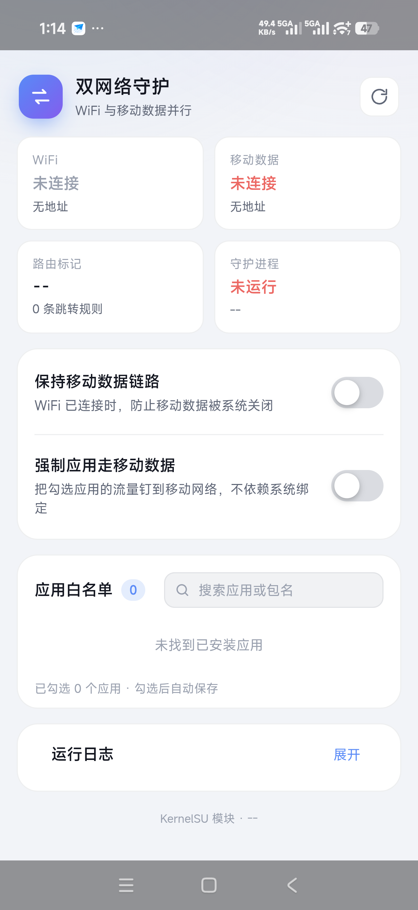
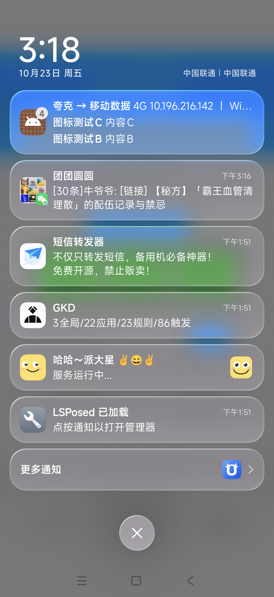

# 双网络守护 (dualnet_keep)

一个 KernelSU 模块：让 **WiFi 与移动数据真正同时可用**，解决 HyperOS / MIUI 上「仅使用移动数据」的应用在连接 WiFi 后断网的问题。

内置 WebUI，可按应用强制分流，并在状态栏常驻通知实时显示当前应用走的是流量还是 WiFi。

<p align="center">
  
  
</p>

## 解决的痛点

在 手机管家 / 安全中心 → 网络助手 里，把某个应用设为「仅使用移动数据」后，一旦连上 WiFi，这个应用就断网了。

原因不是移动数据断了 —— 实测连上 WiFi 后：

```bash
ip -4 addr show
#   inet 10.196.216.142/30 scope global rmnet_data3   ← 移动数据仍然有 IP
#   inet 192.168.31.127/24 scope global wlan0         ← WiFi 也持有地址

dumpsys telephony.registry | grep mDataConnectionState
#   mDataConnectionState=2                            ← 数据连接保持 CONNECTED
```

链路是活的。真正断网发生在应用层：**网络助手只做到了「禁止该应用走 WiFi」，却没有把它的流量导到移动数据上**。WiFi 成为默认网络后，这些应用的连接走 WiFi 被拦掉，于是表现为「没网」。

本模块做的就是补上这一步：给指定应用的流量打上内核路由规则，让它们在 `connect()` 阶段直接选中移动数据的源地址，完全绕开 WiFi。

## 工作原理

### 1. 按 UID 强制路由（核心）

```
ip rule add from all uidrange <uid>-<uid> lookup rmnet_dataX pref 15060
```

这一步决定了成败。**必须在 socket 建立连接前就选对路由表**，否则源地址会被定死在 WiFi 的 IP 上。

### 2. iptables MARK 兜底

```bash
iptables -t mangle -I OUTPUT -m owner --uid-owner <uid> -j MARK --set-xmark 0x1006d/0x1ffff
```

给已经建立的连接补充标记，覆盖部分边缘场景。

### 3. 多用户 / 应用分身

分流规则覆盖设备上**所有用户**，不只是主空间：

| 用户 | 说明 | 微信的 UID |
|---|---|---|
| 0 | 主空间 | `10336` |
| 10~14 | 第二空间 / 小云空间 | `1010336` ~ `1410336` |
| 999 | 应用分身（XSpace） | `99910336` |

UID 由 `userId × 100000 + appId` 得出，直接通过 `pm list packages -U --user <id>` 读取 PackageManager 的真实值，不靠字符串拼接推算（早期版本用 `"1$uid"` 拼接，遇到 4 位 appId 会算错）。

应用列表同样合并了所有用户的第三方应用，按包名去重。

### 4. 保持数据通路

- 维护 `mobile_data` / `mobile_data_always_active` / `mobile_data_always_on` 三个设置项
- 常驻进程通过 `ConnectivityManager.requestNetwork(CELLULAR)` 向系统声明「有应用需要蜂窝网络」，阻止 WiFi 连接时 PDN 被回收

> 模块**从不调用** `svc data disable/enable`。早期版本尝试过「检测到接口消失就重连」，结果 WiFi 切换瞬间的接口抖动会触发误判，反复关开数据反而把网络弄断了。

## 功能

| 功能 | 说明 |
|---|---|
| 强制走移动数据的应用 | 勾选后，该应用全部流量从 `rmnet_dataX` 出，不依赖系统绑定 |
| 中文应用名 | 通过 `PackageManager.getApplicationLabel()` 取本地化名称，支持中文搜索 |
| 应用图标 | 真实图标以 webp + base64 内联，按版本号缓存，不重复传输 |
| 公网 IP 查询 | 分别通过 WiFi / 蜂窝网络请求，显示两条链路的实际出口 IP |
| 状态栏常驻通知 | 实时显示当前前台应用走流量还是 WiFi，带应用图标 |
| 秒开 | 应用列表与图标均三层缓存（后端文件 → localStorage → 版本校验） |

## 安装

```bash
# 1. 推送模块
adb push dualnet /data/local/tmp/dualnet
adb push build/install.sh /data/local/tmp/install.sh

# 2. 安装
adb shell su -c "sh /data/local/tmp/install.sh"
```

或者手动复制到 `/data/adb/modules/dualnet_keep/`，重启手机由 KernelSU 自动拉起。

安装后在 **KernelSU 管理器 → 模块 → 双网络守护 → 打开** 进入 WebUI。

## 使用

1. 在 WebUI 里勾选那些「只允许用移动数据」的应用
2. 勾选即保存，30 秒内自动生效（也可点刷新立即应用）
3. 状态栏通知会显示当前前台应用的分流状态

### 命令行

```bash
CTL=/data/adb/modules/dualnet_keep/scripts/ctl.sh

su -c "sh $CTL status"        # 查看状态
su -c "sh $CTL apps"          # 应用列表
su -c "sh $CTL apply"         # 立即重建规则
su -c "sh $CTL log"           # 运行日志
su -c "sh $CTL publicip"      # 两条链路的公网 IP
```

配置文件在 `/data/adb/dualnet/`：

| 文件 | 作用 |
|---|---|
| `apps.conf` | 每行一个包名，强制走移动数据 |
| `keep_data` | 存在则维护数据开关 |
| `force_route` | 存在则启用分流规则 |
| `notify_off` | 存在则关闭状态栏通知 |
| `daemon.log` | 守护进程日志 |

## 构建 dex

WebUI 调用的应用名、图标、公网 IP、保活等功能依赖内嵌的 dex（`dualnet/tools/label.dex`）。修改 `java/dualnet/*.java` 后需要重新编译：

```bash
# Windows
powershell -ExecutionPolicy Bypass -File build/build-dex.ps1

# Linux / macOS
bash build/build-dex.sh
```

需要 `JAVA_HOME` 与 Android SDK（`ANDROID_SDK_ROOT`），会用到 `android.jar` 和 `d8`。

| 源文件 | 作用 |
|---|---|
| `LabelDump.java` | 导出 包名\|应用名\|uid |
| `DumpIcons.java` / `DumpIcon.java` | 导出应用图标（全部 / 单个） |
| `PublicIp.java` | 分别经 WiFi 与蜂窝查询出口公网 IP |
| `KeepAlive.java` | 常驻请求蜂窝网络，阻止 PDN 被释放 |
| `Notify.java` | 早期尝试用 NotificationManager 发通知（保留作参考） |

## 踩过的坑

记录几个非显然的问题，供后来者参考。

### iptables MARK 无法改变源地址

最初只用 `iptables -t mangle -j MARK`，结果应用所有连接卡在 `SYN_SENT`：

```
192.168.31.127:9D1A → 6.6.6.6:443  state=02 (SYN_SENT)   # 源地址是 WiFi 的 IP
```

包确实被打了 mark，但**源 IP 在 `connect()` 那一刻就由路由表定死了**，mangle 阶段再改标记也改不了源地址。必须用 `ip rule` + `uidrange` 在选路阶段介入。

改用后同一应用：

```
10.196.216.142:DA74 → ...:443  state=01 (ESTABLISHED)     # 源地址变成移动数据
```

### root 无法发通知

```bash
cmd appops get root POST_NOTIFICATION
# Uid mode: POST_NOTIFICATION: ignore
```

root 的通知权限是被禁的，`cmd notification post` 在 `su` 下静默失败。最终方案是降权到 shell 用户：

```bash
busybox setuidgid 2000 cmd notification post -S bigtext -t "标题" tag "内容"
```

### 状态栏蜂窝图标无法通过 root 修改

WiFi 连接后蜂窝图标消失是 `SystemUI` 的 Java 逻辑决定的，root 改不动已经编译进 APK 的分支，需要 LSPosed hook（可试试 HyperCeiler）。**该图标仅影响显示，不影响实际功能。**

### `adb push` 到已存在目录会嵌套

```bash
adb push dualnet /data/local/tmp/dualnet   # 第二次执行会变成 /data/local/tmp/dualnet/dualnet
```

覆盖部署前先 `rm -rf` 目标目录。

## 兼容性

在以下环境验证：

- 设备：Redmi 25102RKBEC
- 系统：HyperOS OS4.0.4.0（Android 17）
- Root：KernelSU（官方 `me.weishu.kernelsu`）

原理上适用于所有支持 `ip rule uidrange` 的 Android 版本，但 KernelSU WebUI 的 `ksu.exec` 在部分版本是 callback 风格而非 Promise，`webroot/app.js` 已做双兼容处理。

## 卸载

KernelSU 管理器里卸载，或：

```bash
su -c "rm -rf /data/adb/modules/dualnet_keep /data/adb/dualnet"
```

`uninstall.sh` 会清理 iptables 规则、ip rule 和常驻进程。

## 免责声明

修改网络路由与系统设置存在风险，请自行评估。因使用本模块导致的任何问题（包括但不限于流量超额、系统异常、设备故障）由使用者自行承担。

## License

[MIT](LICENSE)
